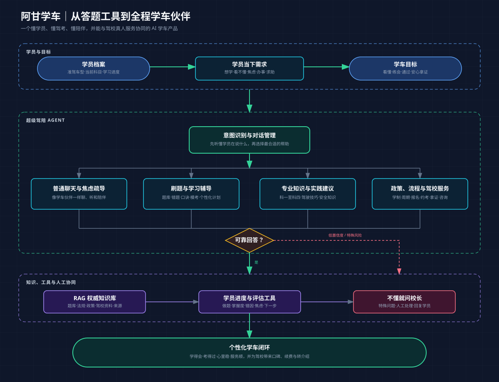

# 阿甘学车｜AI 学车伙伴

## 我们最终要做成什么

阿甘学车的最终目标，不是再做一个只会出题和对答案的刷题软件，而是成为学员从报名到拿证全过程中的 **AI 学车伙伴**。

核心 AI 角色“**超级驾陪**”需要同时懂得：

- **懂学员**：知道他学什么车型、到了哪个科目、卡在哪里，也能听懂焦虑和气馁。
- **懂驾考**：能准确回答理论题、解释驾驶技巧、制定学习计划，并用题库、错题、口诀和模考帮助学员通过考试。
- **懂服务**：能解释政策、学制、约考、拿证周期和驾校流程，不确定或高风险问题交给真人校长。
- **会越用越懂你**：结合学员档案、学习进度、错因和反馈，持续调整建议，而不是每次从头开始。

对学员，它是一个有陪伴价值且回答准确的学车 AI；对驾校，它是一套能够进入一线服务、连接学员档案和真人教练的智能服务能力。最终用更好的学习体验、更稳定的考试通过和更顺畅的服务，带来口碑、续费与转介绍。

## 产品蓝图

## 线上测试入口

- [学员端｜体验阿甘学车](https://sjg752jmtbn2sckvrv72q.apigateway-cn-beijing.volceapi.com/enter)
- [校长端｜打开校长工作台](https://sjg752jmtbn2sckvrv72q.apigateway-cn-beijing.volceapi.com/staff/enter)

> 当前为邀请制测试版，请向项目管理员获取对应身份的邀请码。本仓库已开放源代码，用于展示产品方案与当前实现；邀请码、线上环境密钥、正式题库和学员数据不会进入仓库。

## 当前代码版本：V2.2 Beta.2（邀请制试点候选）

- [当前正式 PRD：阿甘学车教育 Agent V2.2](./阿甘学车教育Agent_PRD_V2.2_2026-10-17.md)
- [准商用验收与差距报告](./03_PRD过程版本/阿甘学车_V2.2_准商用验收报告_2026-10-17.md)
- [PRD 版本索引与归档规则](./03_PRD过程版本/PRD版本索引.md)
- [PE 与 Skill 修复验收报告](./03_PRD过程版本/V2.2_PE与Skill修复验收报告_2026-10-17.md)

### Beta.2 对话与技能修复

- 听懂“不想刷题”“别打开错题本”，只有明确请求才给导航确认入口。
- 合并讲题与聊天上下文，承接车型、城市、学习阶段；刷新后普通聊天不再丢失。
- Skill 接入真实练习统计、已编排口诀和校长工单确认，不再只描述能力。
- 政策数字与来源独立呈现，模型不重新编写事实；不能把历史资料当最新政策。
- 修复旧数据库缺少向量列、本地 1,388 条向量缺失，以及开放问题错用判断题答案的问题。
- 真实模型回归与桌面/手机端验证结果、已知限制见修复验收报告。

> 此处是代码版本，不代表上方线上链接已更新到 Beta.2。本次同步 GitHub，不自动部署生产环境。

### V2.2 本次更新

- 增加有签名、可过期的学员端与校长端会话，降低伪造和长期泄露风险。
- 为登录、AI 消息和图片上传增加服务端限流，并加入生产配置就绪检查接口。
- 修复模拟考试倒计时结束后不自动交卷、空题无法按未答计错和退出误操作问题。
- 增加最近对话入口与退出登录，补齐此前无效的顶部操作。
- 为前端加入基础安全响应头，并统一用户可见工单状态文案。
- 完成 60 项后端测试、9 项前端单元测试和 10 项桌面/移动端端到端场景验证。

> 工程验收通过不等于已经具备无条件商用资格。当前适合邀请制真实学员试点；正式收费推广前仍需完成授权题库、独立 RAG 评测、生产数据库、可观测性、压力/安全测试及隐私合规验收。

### 已经完成

- 学员邀请制进入、对话式首页与移动端交互。
- “超级驾陪”普通聊天、焦虑疏导、学车意图识别和口语化回复。
- C1 科目一刷题、错题、收藏、模拟考试、答案解释与学车口诀框架。
- 文字与图片提问、OCR 校正确认流程。
- RAG 知识库基础链路，当前连接 1,388 条 C1 题库预览数据。
- “不懂就问校长”工单、校长工作台、知识条目管理与评测页面。
- 敏感信息、提示词注入与高风险问题的基础防护。
- 图片知识卡、场景卡刷题与首个动态教学演示框架。
- 学员端与校长端已部署到线上测试环境，数据持久化已接入 TOS。

### 下一步重点

- 用正式授权题库替换研究预览数据，补全法规、政策、学制、约考和拿证流程等权威知识。
- 把学员档案、学习进度、错因和学习计划真正打通，形成长期记忆与个性化辅导。
- 完成 C2 理论共用与其他准驾车型、科目二至科目四的知识和服务框架。
- 建立回答准确性、陪伴体验、意图识别、RAG 命中和安全攻防的评测集。
- 开展压力测试、并发测试、故障注入、日志监控、成本监控与正式题库切换验收。

## 仓库与运行说明

- 前端：Next.js + TypeScript。
- 后端：FastAPI + SQLite（测试版）。
- 模型：通过后端调用，API Key 不会下发到浏览器。
- 部署：火山引擎 veFaaS + APIG，持久化备份使用 TOS。
- 安全：不提交 `.env` 或任何真实密钥；邀请码不在公开体验页面展示。

本地和测试环境不提供默认邀请码。运行前必须通过未提交的私有环境变量配置 `LEARNER_INVITATION_CODE` 和 `STAFF_INVITATION_CODE`。
